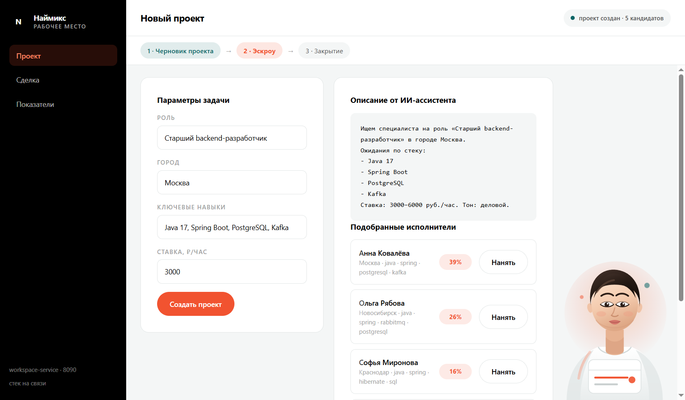
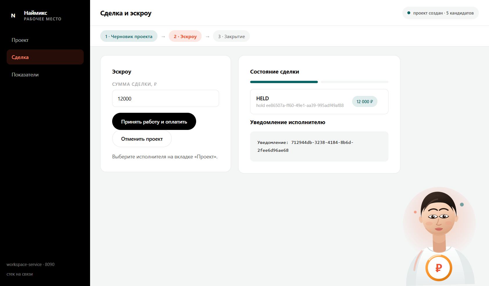
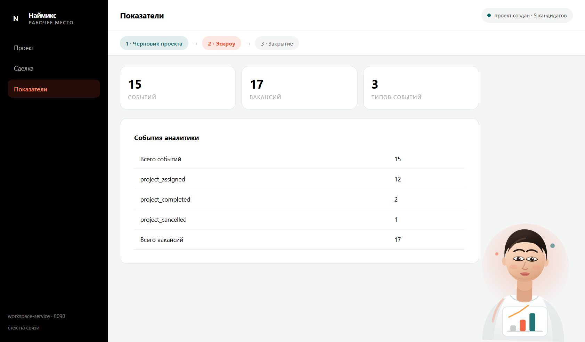

# Наймикс · платформа внештатных специалистов

Учебно-боевой проект: восемь Spring Boot сервисов, бизнес-оркестратор, веб-портфолио и оконное
приложение кабинета заказчика. Всё работает локально на настоящих PostgreSQL и Redis.

## Оконное приложение







### Скриншоты прямыми ссылками

Папка: [desktop/screenshots](desktop/screenshots)

1. [01-project-draft.png](desktop/screenshots/01-project-draft.png) — новый проект с ИИ-описанием и подбором
2. [02-escrow-held.png](desktop/screenshots/02-escrow-held.png) — сделка, эскроу HELD, уведомление
3. [03-kpi.png](desktop/screenshots/03-kpi.png) — показатели аналитики

Персонаж в правом нижнем углу — векторная иллюстрация с градиентами, светом и деталями лица.
Он меняется при переходе между разделами: на «Проекте» держит карточку задачи, на «Сделке» —
монету с ₽, на «Показателях» — карточку с графиком. Поза слегка наклоняется, а при прокрутке
фигура плавно смещается вместе с контентом (переменная `--scroll` и `data-view` на `body`).

Electron-приложение (`desktop/`) — рабочее место заказчика: создание проекта с ИИ-описанием,
подбор исполнителей, эскроу-сделка, показатели аналитики. Стиль повторяет сайт компании:
чёрная навигация, оранжевый акцент, скругления 16/30, шрифт Onest.

```powershell
cd desktop
npm install
npm start          # обычный запуск
npm run shots      # пересъёмка скриншотов в desktop/screenshots
```

Скриншоты снимаются самим приложением через `webContents.capturePage()` на живом бэкенде,
без ручных инструментов.

## Архитектура

| Компонент | Порт | Ответственность |
| --- | --- | --- |
| `auth-service` | 8081 | Spring Security, OAuth 2.0 resource server, JWT, отзыв токенов |
| `vacancy-service` | 8082 | JPA, пагинация, кэш read-through, оптимистичная блокировка |
| `matching-service` | 8083 | TF-IDF и косинусная близость, ранжирование исполнителей |
| `notification-service` | 8084 | идемпотентность по ключу, ретраи, парковка в DEAD |
| `billing-service` | 8085 | холды, `PESSIMISTIC_WRITE`, инварианты денежных операций |
| `analytics-service` | 8086 | счётчики, агрегаты, метрики JVM |
| `ai-assistant-service` | 8087 | провайдер генерации, квота клиента, 429 |
| `workspace-service` | 8090 | бизнес-оркестрация: черновик, эскроу, приёмка, отмена |
| `web/` | — | портфолио, технические демо, кабинет в браузере |
| `desktop/` | — | оконное приложение Electron |

## Бизнес-процесс

```
POST /api/workspace/projects               -> ИИ-описание + ранжированные исполнители
POST /api/workspace/projects/{id}/assign    -> эскроу HELD + уведомление
POST /api/workspace/projects/{id}/complete  -> эскроу CAPTURED
POST /api/workspace/projects/{id}/cancel    -> эскроу RELEASED
GET  /api/workspace/overview                -> события аналитики + число вакансий
```

Идемпотентность держится на ключах `hold-<vacancyId>` и `assign-<vacancyId>`, кошелёк создаётся
идемпотентно по владельцу.

## Запуск

```powershell
# данные: PostgreSQL 16.2 портативно на 5440, Redis на 6379
scripts\start-stack.ps1     # поднимает всё и ждёт готовности
scripts\stop-stack.ps1
```

Сервисы стартуют последовательно с лимитом памяти (`-Xmx256m -Xss512k -XX:ActiveProcessorCount=2`),
иначе восемь JVM не помещаются в память одновременно.

## Качество кода

- **Checkstyle** (`config/checkstyle/checkstyle.xml`), фаза `verify`: `ReturnCount=1`,
  `ExecutableStatementCount=2`, запрет `break`/`continue`/`while`/`do`, сложность ≤ 3,
  javadoc на публичных методах. `mvn verify` — 9 модулей, 18 тестов, 0 нарушений.
- **ESLint** (`web/eslint.config.mjs`, `desktop/eslint.config.mjs`): `max-statements: 2`,
  `complexity: 3`, те же запреты циклов и переходов для JS.

Побочный эффект жёстких правил — код фрагментирован на микрофункции; компромисс зафиксирован
в `docs/adr/0006-code-style-limits.md`.

## Документация

- `docs/adr` — шесть решений с контекстом, альтернативами и последствиями.
- `docs/c4` — контекст, контейнеры, компоненты, состояния холда.
- `infra/README.md` — установка PostgreSQL/Redis/Docker, K8s-манифесты.

## Ограничения

- PostgreSQL и Redis поставлены портативно в обход установщиков (нужны права администратора).
- Агрегированный `/actuator/health` сервисов с Redis отдаёт 503 из-за несовместимости
  Redis 5 с парсером `INFO` в Spring; пробы `readiness`/`liveness` возвращают 200 и используются в K8s.
- ИИ-фичи работают на локальных детерминированных движках, внешние модели не подключены.
- В манифестах и конфигах лежат демонстрационные пароли (`naimix`, `postgres`) — не для production.
