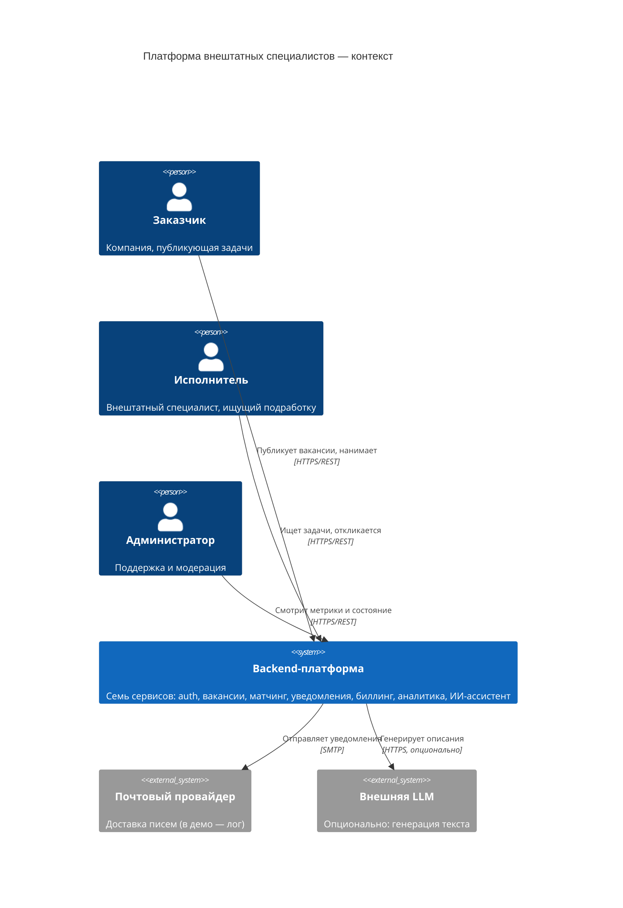

# C4 уровень 1. Контекст

## Акторы и цели

| Актор | Что делает | Какие сервисы затрагивает |
| --- | --- | --- |
| Заказчик | Публикует вакансию, резервирует оплату | vacancy, billing, matching, assistant |
| Исполнитель | Ищет задачи, получает уведомления | matching, notification, auth |
| Администратор | Наблюдает метрики и здоровье системы | analytics, actuator |

## Границы системы

Внутри: бизнес-логика платформы. Снаружи: почтовый провайдер и внешняя LLM — обе точки заменяемы
интерфейсами (`ChannelSender`, `GenerationProvider`), в демо-режиме работают локальные реализации.
