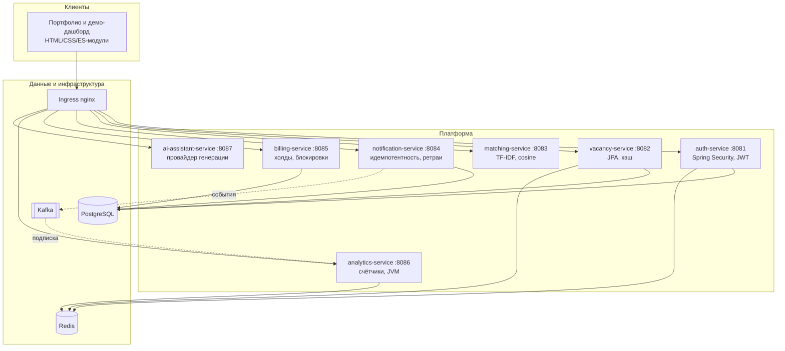
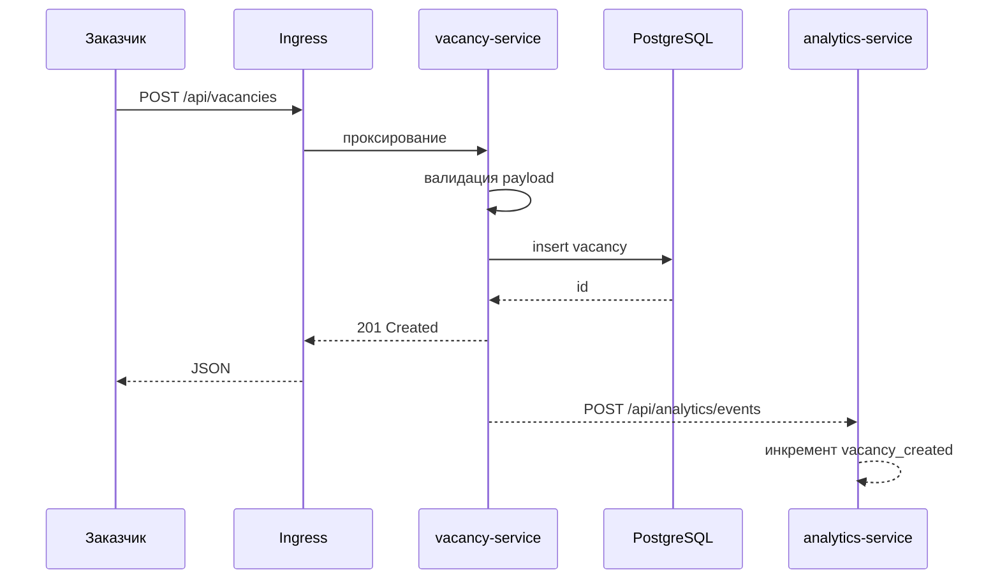

# C4 уровень 2. Контейнеры

## Ответственность контейнеров

| Контейнер | Порт | Состояние | Ключевой риск |
| --- | --- | --- | --- |
| auth-service | 8081 | PostgreSQL + Redis | компрометация секрета подписи |
| vacancy-service | 8082 | PostgreSQL + кэш | расхождение кэша и БД |
| matching-service | 8083 | in-memory индекс | рост каталога профилей |
| notification-service | 8084 | PostgreSQL | дубли доставки при ретраях |
| billing-service | 8085 | PostgreSQL | конкуренция за кошелёк |
| analytics-service | 8086 | Redis или память | потеря счётчиков при рестарте |
| ai-assistant-service | 8087 | память | злоупотребление квотой |

## Поток запроса «опубликовать вакансию»

