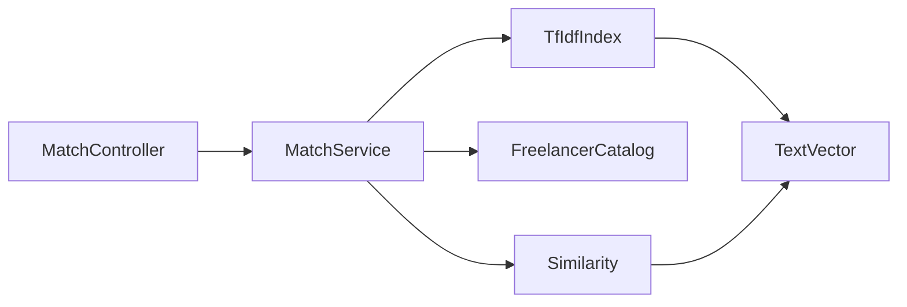
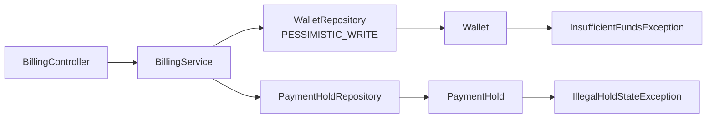
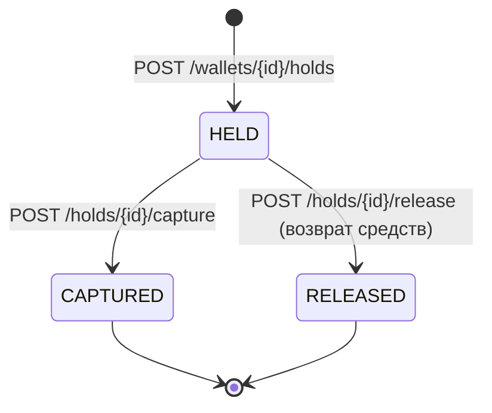

# C4 уровень 3. Компоненты: matching-service и billing-service

## matching-service

| Компонент | Ответственность |
| --- | --- |
| MatchController | приём запроса, валидация текста |
| MatchService | векторизация запроса, ранжирование, отсечение по limit |
| TfIdfIndex | словарь и веса IDF по корпусу профилей |
| TextVector | токенизация и частоты |
| Similarity | косинусная близость с защитой от нулевой нормы |
| FreelancerCatalog | каталог профилей (в демо — в памяти) |

## billing-service

| Компонент | Ответственность |
| --- | --- |
| BillingController | REST-контракт кошельков и холдов |
| BillingService | идемпотентность по ключу, порядок операций |
| Wallet | инвариант «баланс не отрицателен» |
| PaymentHold | конечный автомат HELD → CAPTURED/RELEASED |
| WalletRepository | блокировка строки на время транзакции |

## Жизненный цикл холда

Повторный `capture` или `release` невозможен: `guardHeld()` бросает `IllegalHoldStateException`,
контроллер возвращает 409.
